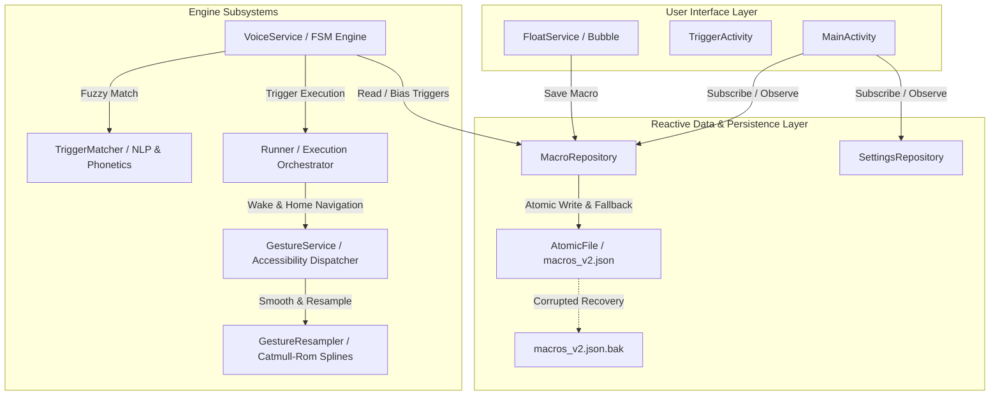
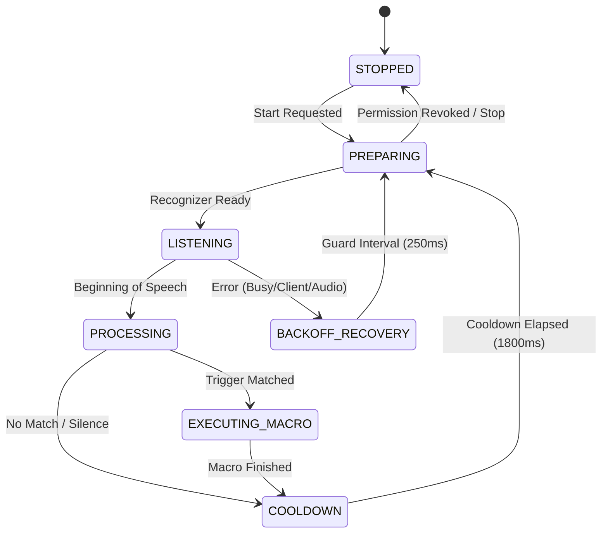

# SayDo System Architecture & Engineering Specification

## 1. Overview & Core Philosophy

SayDo is an ultra-reliable, zero-compromise voice automation system for Android (API 26 to API 35). It empowers users to record physical multi-touch macros (taps, holds, swipes) and trigger them using 100% offline English voice commands anywhere in the operating system—including the lock screen.

### Non-Negotiable Operational Principles
- **100% Offline Speech Recognition**: Never relies on cloud services; utilizes Android's on-device speech engine with offline English language packs.
- **Zero Separate Settings Screen**: A frictionless sequential Auto Start chain on the `START` button resolves only missing system permissions.
- **Sub-Millisecond 1:1 Gesture Fidelity**: Touch points are captured and replayed with microsecond timestamps and sub-pixel normalization.
- **Zero Visual Clutter**: No lines, dots, or borders appear on screen during recording; touches pass directly through to underlying applications.
- **Zero Polling / 0% Idle CPU**: The user interface and background services operate entirely on reactive push subscriptions.

---

## 2. High-Level Architecture Diagram

---

## 3. Reactive Repository & Atomic Storage Subsystem

### 3.1 Domain Models
- [`TouchPoint`](file:///home/muhamad/SayDo/app/src/main/java/uz/saydo/app/data/TouchPoint.java): Immutable coordinate `(double x, double y, long t)` normalized to `[0.0, 1.0]` with strict validation rejecting `NaN` and negative timestamps.
- [`Gesture`](file:///home/muhamad/SayDo/app/src/main/java/uz/saydo/app/data/Gesture.java): Typed representation of an interaction (`tap`, `hold`, `swipe`, `global`), containing immutable touch points and timing metrics.
- [`Macro`](file:///home/muhamad/SayDo/app/src/main/java/uz/saydo/app/data/Macro.java): Immutable automation entity holding a unique UUID, normalized trigger phrase, list of gestures, duration, and lock-screen flag.

### 3.2 Atomic File Persistence & Fault Recovery
- **Atomic Writes**: Writes first to a temporary file (`macros_v2.json.tmp`), flushes file descriptors via `fos.getFD().sync()`, rotates the existing file to `macros_v2.json.bak`, and renames the temporary file atomically.
- **Corrupted Backup Recovery**: If `macros_v2.json` is missing or corrupted by abrupt power loss, `MacroRepository` automatically restores from `macros_v2.json.bak`.
- **Legacy Migration**: Automatically migrates legacy v1 SharedPreferences strings to typed v2 models without data loss.
- **Thread Safety**: Access is guarded by a `ReentrantReadWriteLock` ensuring lock-free concurrent reads and synchronized atomic mutations.

---

## 4. Continuous Offline Speech Recognition FSM

The speech engine operates as a formalized Finite State Machine (FSM) to prevent resource contention, audio device lockup, and recognizer crashes.

### 4.1 FSM States
1. **`STOPPED`**: Service is idle; audio hardware and wake locks released.
2. **`PREPARING`**: Offline model verified, audio focus requested, recognizer instantiated.
3. **`LISTENING`**: Active microphone sampling with partial results processing.
4. **`PROCESSING`**: Speech detected; running token windowing and phonetic matching.
5. **`EXECUTING_MACRO`**: Microphone paused, wake lock released, gesture playback active.
6. **`COOLDOWN`**: Guard period preventing self-triggering from ambient echo or repetitive phrases.
7. **`BACKOFF_RECOVERY`**: Exponential backoff handling transient audio server restarts.

### 4.2 NLP & Phonetic Trigger Matching Engine
- **Contraction Normalization**: Pre-tokenization expansion (`can't` -> `cannot`, `won't` -> `will not`, `it's` -> `its`).
- **Damerau-Levenshtein Distance**: Optimal string alignment detecting single-character transpositions (`teh` -> `the`, `caemra` -> `camera`) alongside insertions and deletions.
- **Phonetic Hybrid (Metaphone + Soundex)**: Dual phonetic fingerprinting tolerates regional accents and silent English letters (`knight` -> `night`, `weather` -> `whether`).
- **Sibling Prefix Disambiguation**: Prevents shorter commands (e.g., `"open"`) from prematurely executing when the user speaks longer composite phrases (e.g., `"open camera"`).

---

## 5. Sub-Millisecond Gesture Capture & Replay Subsystem

### 5.1 FloatService Physics & Window Management
- **Edge Docking Physics**: Decelerates and smoothly snaps the bubble to the nearest screen edge upon release.
- **Half-Dock Auto-Collapse**: Collapses into a subtle 55% opacity pill after 3.5s of inactivity to minimize screen obstruction.
- **Safe Area & Cutout Inset Handling**: Automatically clamps bubble coordinates inside display safe zones, preventing placement under camera notches.
- **Orientation Adaptation**: Handles configuration changes (`onConfigurationChanged`) by recalculating display bounds and clamping bubble coordinates.

### 5.2 Pass-Through Touch Recording
- **Batched Touch Extraction**: Collects all historical touch samples (`getHistoricalX/Y/EventTime`) with microsecond precision.
- **Touch Slop Filtering**: Distinguishes between stationary taps, long holds, and deliberate swipes using a 12dp squared distance threshold.
- **Zero Visual Lines**: Touches pass immediately through to underlying applications without drawing lines or dots on screen.

### 5.3 Spline Smoothing & Multi-Stroke Continuation
- **Catmull-Rom Splines**: Smooths erratic digitizer jitter while preserving recorded velocities and corner points.
- **Duration Segmentation**: For gestures exceeding Android's `getMaxGestureDuration()`, strokes are automatically segmented using `StrokeDescription.continueStroke(...)` for unbroken continuous execution.
